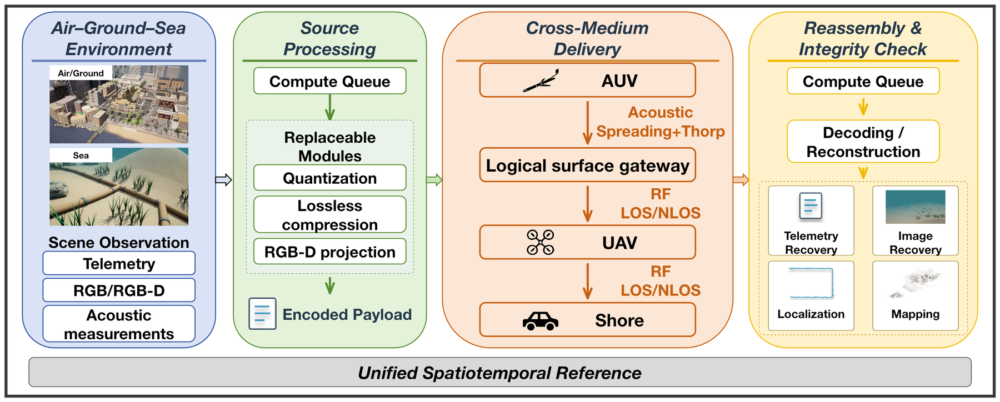
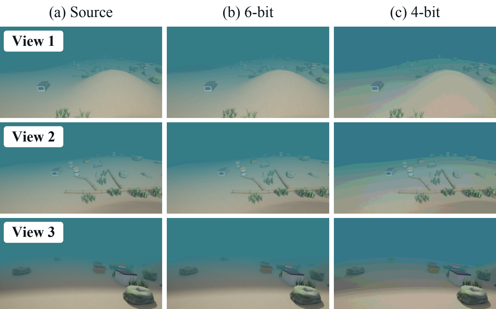
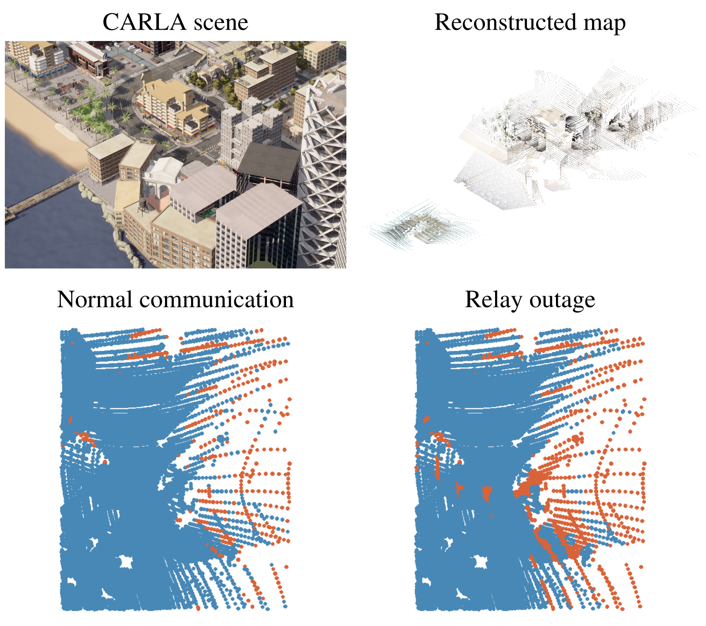
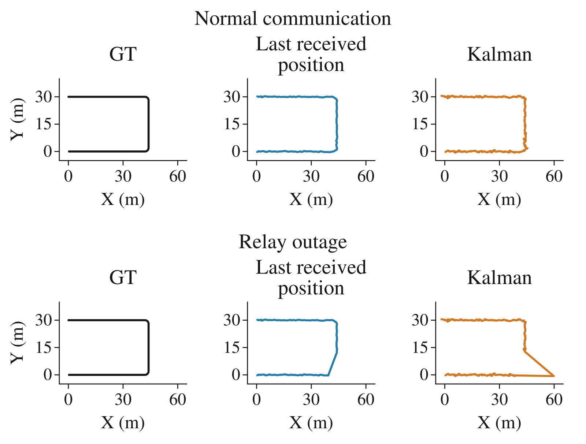

# TriMedium

### A Cross-Medium Simulator for Embodied Networking Across Air-Ground-Sea

TriMedium is an integrated Air-Ground-Sea simulator for studying cooperation among heterogeneous robotic platforms. It connects motion and sensing in a shared three-dimensional environment with data processing, acoustic and radio-frequency (RF) communication, and receiver-side tasks. A common simulation clock determines when observations are acquired, delivered, and available for use.

*Platform overview. Observations pass through configurable processing and communication stages before supporting reconstruction, mapping, or positioning at the receiver.*

## Highlights

- **Shared Air-Ground-Sea environment.** Aerial, ground, and underwater entities share a spatial reference and simulation clock. Vehicle states, RGB images, and rendered depth provide inputs for cooperative tasks.
- **Cross-medium data delivery.** Acoustic links connect underwater nodes to surface gateways, while RF links support aerial and ground relaying. Link distances, propagation losses, queueing, and forwarding determine when reports arrive.
- **Replaceable processing methods.** Quantization, compression, and corresponding reconstruction methods can be replaced. Encoded payload sizes and modeled processing delays enter the same delivery workflow.
- **Traceable observations and delivery.** Acquisition timestamps are retained throughout the workflow. Chunk reassembly, length verification, and hash checks distinguish delivery problems from intentional quantization distortion.

## Case Studies

### 1. Multimodal Data Delivery

A moving autonomous underwater vehicle (AUV) reports state telemetry and RGB observations to a shore receiver through a surface gateway and an unmanned aerial vehicle (UAV) relay. Telemetry and images are evaluated in separate experiments. Direct transmission, lossless compression, and two quantization-plus-compression configurations use identical source observations within each experiment.

*Source and reconstructed RGB images. Each row uses the same source frame across all three columns. The columns show the source, 6-bit quantization with zlib, and 4-bit quantization with zlib.*

This case demonstrates complete observation delivery and reconstruction, while exposing the effects of payload processing on transmission demand, delay, and recovered image quality.

### 2. Air-Ground-Sea Mapping

Underwater, aerial, and ground observations contribute to a common coastal map. RGB images and rendered depth are projected into local point clouds using known camera poses. Compressed point clouds are transmitted to shore, where only delivered observations are fused into the map.

*Scene context and shore-side mapping. The lower panels compare the same underwater reference region under normal communication and a relay outage. Blue reference points lie within 1 m of the map; orange points do not. The scene view is horizontally mirrored for display.*

Comparing normal communication with a UAV-relay outage shows how the availability of observations affects the map assembled at the receiver.

### 3. Cross-Domain AUV Positioning

A surface reference node obtains simulated acoustic range and angle measurements of a moving AUV. After acoustic measurement acquisition, reports travel through a UAV relay to shore over RF links. The receiver compares holding the last received position with constant-velocity Kalman prediction, using the same delivered measurements.

*Shore-side AUV positioning for one measurement-noise realization. The top row shows normal communication; the bottom row shows a relay outage. Columns show ground truth, the last received position held until the next report, and Kalman estimates.*

This case connects measurement availability with receiver-side tracking, making the effects of delayed or interrupted reporting visible alongside vehicle motion.

## Availability

This repository currently provides an overview of TriMedium and visual examples from three case studies. Source code and experiment configurations have not yet been released.

## Acknowledgments

TriMedium reuses the aerial and ground simulation infrastructure of [CARLA-Air](https://github.com/louiszengCN/CarlaAir), which integrates CARLA and AirSim.
